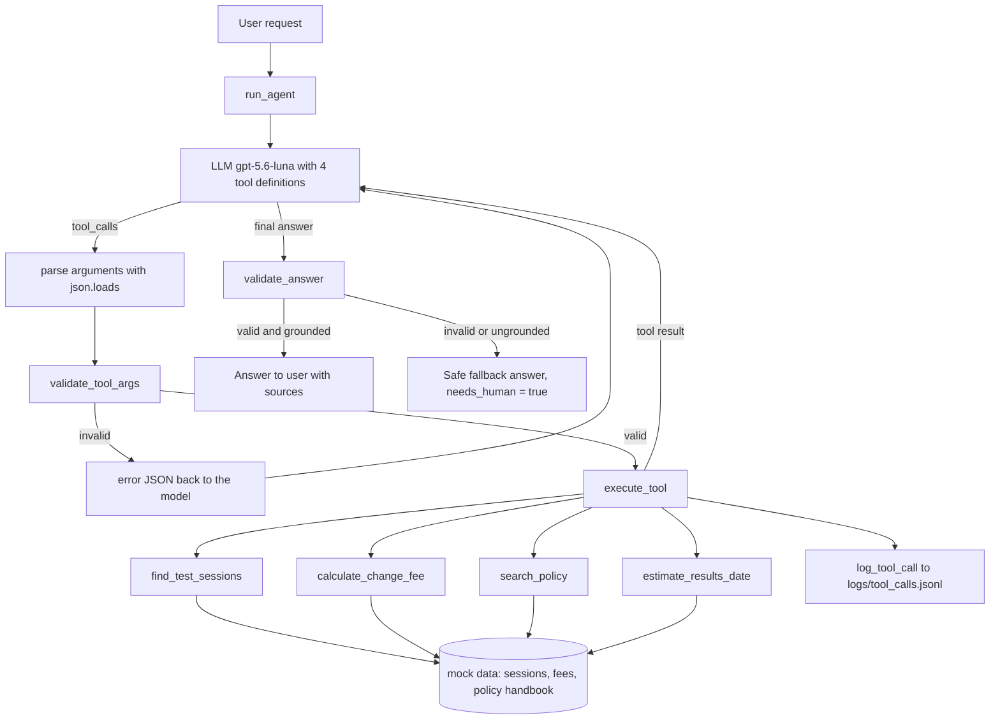

# Project Proposal — Semester Week 10

## Project Title

IELTS Candidate Assistant: a tool-using agent that answers test registration questions from real data, not from memory

## Problem Description

People who plan to take IELTS ask the same practical questions again and again: which test dates are still open in my city, how much it costs to move my test to another date, what documents I must bring on test day, and when my results will be ready. Today these answers are spread across a schedule, a fee table and a long policy handbook, so a candidate either searches for a long time or writes to the support team and waits.

A plain chatbot is not a good answer to this problem. A general LLM does not know the current schedule of a specific test centre and will happily invent a date, a number of free seats or a transfer fee. In this domain a wrong answer costs real money: a candidate who trusts an invented deadline can miss the transfer window and lose part of the test fee.

The goal of the project is an agent that answers these questions only from tool results. The model decides which tool it needs (schedule search, fee calculation, policy search, results date), my code runs the tool on the data, and the model writes the answer from what the tool returned. If the data does not contain the answer, the agent must say so and point the candidate to a human instead of guessing.

All data in the project is mock data that I write myself (a fictional test centre with sessions in Almaty, Astana and Shymkent, a simplified fee table and a simplified policy handbook). No real candidate data, no internal company data and no official prices are used. The rules are simplified versions written for the project and are not official IELTS policy.

## Target Users

1. IELTS candidates who want a quick and correct answer about dates, fees, rules and results without waiting for the support team.
2. Support staff at a test centre, who can use the agent as a helper to answer typical questions faster and spend their time on the cases that really need a human (medical cancellations, complaints, special arrangements).

## Selected Difficulty

C (tool-using agent). The LLM selects and calls at least two meaningful tools, the arguments are validated, the answers are grounded in tool results, every tool call is logged, and the project has at least eight tests.

## Expected Functionality

1. Search for available test sessions by city, module (Academic or General Training), delivery format (computer or paper) and date range, including the number of free seats and the registration deadline.
2. Calculate the fee or refund for transferring or cancelling a booking, based on how many days are left before the test date.
3. Search the policy handbook and answer rule questions (ID documents, what to bring, late arrival, Enquiry on Results, One Skill Retake) with a reference to the handbook section that was used.
4. Estimate the date when results will be available for a given session.
5. Answer simple requests that need no tool (greetings, explaining the difference between Academic and General Training in general terms, helping to write a polite email to the centre) without calling tools.
6. Handle missing or unavailable information honestly: a city with no sessions, a session id that does not exist, a question the handbook does not cover. In these cases the agent says that the information is not available and suggests contacting the centre.
7. Return a structured final answer (JSON with the answer text, the sources used, the tools used and a flag for cases that need a human), validate it, and keep a log of every tool call.
8. Survive model and API failures (timeouts, rate limits, server errors) with retries and a clear error message instead of a crash.

## Proposed Functions

The project will be written in Python. The starter Node files and `npm test` stay in place so the repository checks keep working.

| Name | Purpose | Input | Output | Dependencies |
|---|---|---|---|---|
| `load_data()` | Load the mock schedule, fee table and policy handbook once at start | paths to `data/sessions.json`, `data/fees.json`, `data/policy.jsonl` | in-memory data objects | `json`, `pathlib` |
| `find_test_sessions(city, module, delivery, date_from, date_to)` | Find open test sessions that match the filters | `city: str`, `module: "academic" \| "general"`, `delivery: "computer" \| "paper"`, `date_from: str (YYYY-MM-DD)`, `date_to: str (YYYY-MM-DD)` | list of `{session_id, city, date, module, delivery, seats_left, registration_deadline}`; an empty list or `{"error": ...}` with suggestions when the city is unknown | mock schedule |
| `calculate_change_fee(session_id, action, request_date)` | Compute what a transfer or cancellation costs on a given day | `session_id: str`, `action: "transfer" \| "cancel"`, `request_date: str (YYYY-MM-DD)`, optional, defaults to today | `{session_id, days_before_test, policy_window, allowed, fee_kzt, refund_kzt, rule_id}` | mock schedule, fee table, `datetime` |
| `search_policy(query, top_k)` | Find the handbook sections that answer a rule question | `query: str`, `top_k: int` (1 to 5, default 3) | list of `{section_id, title, text, score}` | BM25 (`rank_bm25`), handbook chunks |
| `estimate_results_date(session_id)` | Give the expected results date for a session | `session_id: str` | `{session_id, test_date, delivery, results_date, rule_id}` | mock schedule, fee table rules, `datetime` |
| `validate_tool_args(name, args)` | Check tool arguments against the JSON schema before the tool runs | tool name, parsed `arguments` dict | `None` if valid, or an error message the model can read | `jsonschema` |
| `execute_tool(name, args)` | Dispatch a model tool call to the right Python function and never crash | tool name, `arguments` string from the model | tool result as a JSON string, or `{"error": ...}` | the four tools, `validate_tool_args`, `json` |
| `log_tool_call(record)` | Save every tool call for later analysis | `{request_id, round, tool, args, result, seconds}` | one line appended to `logs/tool_calls.jsonl` | `json`, `time` |
| `complete(messages, tools)` | Model adapter: send the conversation and tool definitions to the LLM | message list, tool schemas | `{text, tool_calls, usage}` | `openai` SDK, `python-dotenv`, retries with back-off |
| `run_agent(user_message, history)` | The agent loop: call the model, run requested tools, return results, repeat until a final answer or the round limit | user text, optional earlier messages | final structured answer | `complete`, `execute_tool`, `log_tool_call` |
| `validate_answer(answer, tool_results)` | Check the final answer: valid JSON with required fields, and every date and amount in it appears in a tool result | final model output, tool results of this request | validated answer, or a safe fallback answer that flags `needs_human: true` | `json`, `re` |

## Proposed Agent Tools

Four functions will be exposed to the model as tools. The model, not my code, decides which of them to call, in which order and with which arguments. Requests that need no tool are answered directly.

| Tool | Why the agent needs it |
|---|---|
| `find_test_sessions` | Dates, free seats and deadlines change and are specific to one centre. The model cannot know them, so it must look them up instead of inventing them. |
| `calculate_change_fee` | The fee depends on the exact number of days before the test and on the policy window. This is date arithmetic plus rules, which a model gets wrong easily (HW4 showed that models make arithmetic slips when they compute in their head). The tool makes the result exact. |
| `search_policy` | The handbook is too long to put into every prompt. The tool returns only the relevant sections, so the answer is grounded and can cite a section id (the same RAG idea as HW3). |
| `estimate_results_date` | Results timing depends on the delivery format and the test date. A small deterministic tool gives a correct date instead of a vague guess. |

Tool design rules, taken from what I learned in HW4:

1. Every tool returns a short JSON object, never a whole document.
2. A tool never crashes: invalid or impossible input returns `{"error": "..."}` with a hint, so the model can fix its call in the next round.
3. A tool never silently guesses. For example, a misspelled city is not auto-corrected; the tool suggests the closest valid cities.
4. Parameter descriptions are written very precisely, because in HW4 one ambiguous sentence in a parameter description changed the accuracy from 15/20 to 19/20.

## Model Selection

Main model: `gpt-5.6-luna` through the OpenAI Chat Completions API with function calling. Reasons: it supports tool calls, it is cheap (about $0.20 per million input tokens and $1.20 per million output tokens), and I already used it in my previous homeworks, so I know its limits: it accepts only the default temperature, and tool calls require `reasoning_effort="none"`.

The model client is a small adapter (`complete(messages, tools)`), so the provider can be changed through configuration. As a backup I will keep an OpenRouter route (same OpenAI-compatible API, different base URL and key), which I used in HW1.

The API key is read from a local `.env` file (`LLM_API_KEY`, `LLM_MODEL`), which is in `.gitignore` and is never committed. Tests of the tools and of the validation logic run without any API key.

## Architecture

Workflow in words: User request → LLM → tool selection → argument validation → tool execution on mock data → tool result returned to the LLM → (repeat if the model needs another tool) → final answer → answer validation → user.

Limits: at most 6 model rounds per request; if the limit is reached the agent stops and returns a fallback answer that asks the user to contact the centre. API errors are retried up to 3 times with back-off.

## Example Requests

1. "Are there computer-delivered Academic tests in Almaty in December?" → the model calls `find_test_sessions(city="Almaty", module="academic", delivery="computer", date_from="2026-12-01", date_to="2026-12-31")` and lists the sessions with free seats and deadlines.
2. "I am booked on session ALA-1212-CD. How much will I pay if I move my test to another date today?" → `calculate_change_fee(session_id="ALA-1212-CD", action="transfer")`, and the answer states the fee and the policy window it is based on.
3. "What ID do I need to bring on test day, and can I use a photo of my passport?" → `search_policy(query="ID documents test day passport copy")`, answer with the section id.
4. "If I take the paper test in Astana on 19 December, when will I get my results?" → the model first calls `find_test_sessions` to get the session id, then `estimate_results_date`: two tools chained by the model's own decision.
5. "Is there a test in Taraz next month?" → the tool returns no sessions for Taraz; the agent says that no sessions are available there and lists the cities that do have sessions, without inventing anything.
6. "Can you help me write a short polite email to the centre to ask about special arrangements for a hearing problem?" → no tool is needed; the model writes the email directly.
7. "What band score will I get if I study for two weeks?" → out of scope; the agent explains that it cannot predict scores and offers what it can help with.

## Evaluation Plan

1. **Unit tests without the API (pytest), at least 8, planned 12 or more:** session search with valid filters, unknown city with suggestions, empty result, fee calculation exactly on and around the window boundaries, cancellation inside the no-refund window, unknown session id, policy search returns the expected section for typical questions, results date for computer and paper delivery, argument validation (wrong type, extra key, value outside the enum), dispatcher with an unknown tool name, answer validation that rejects an amount not present in any tool result.
2. **Failure tests with a mocked model client:** timeout, rate limit (429), server error (500), malformed `arguments` string, tool raising an exception. Expected result: no crash, a clear message, and a logged error.
3. **Scenario evaluation with the real model:** a fixed set of about 20 requests written before the first full run, each with the expected tool (or "no tool") and the expected key facts. Metrics:
   - tool selection accuracy (right tool, or correctly no tool);
   - argument correctness;
   - answer correctness against the expected facts;
   - grounding: number of dates or amounts in answers that do not appear in any tool result (target: 0);
   - correct handling of unavailable information;
   - average rounds, tokens, latency and cost per request.
4. **Repeated runs:** the model only accepts temperature 1, so the scenario set will be run at least twice to see how much the results change between runs, as I did in HW4.
5. **Comparison with a baseline:** the same requests sent to the model without tools, to show how often a plain LLM invents dates and fees.

Results, failures and fixes will be recorded in the weekly reports and in the final report.

## Weekly Milestones

| Week | Dates | Plan |
|---|---|---|
| 10 | Nov 2–8 | Fork the repository, choose topic and level, write this proposal: functions, tools, architecture, examples, evaluation plan and milestones. Week 10 report. |
| 11 | Nov 9–15 | Set up the Python environment, `requirements.txt`, `.env.example`, implement the model adapter `complete()`, run the first real request, commit working code. Write the first version of the mock data files. |
| 12 | Nov 16–22 | Implement the core functions and data loading, structured JSON output and its validation, input validation, first unit tests. |
| 13 | Nov 23–29 | Implement the four tools with JSON schemas, register them with the LLM, let the model select tools, add argument validation and tool call logging. |
| 14 | Nov 30–Dec 6 | Complete the tool-calling loop (several rounds, chained tools), error handling for failed tools and unavailable data, round limit. |
| 15 | Dec 7–13 | Reliability: retries and API failure handling, grounding check of the final answer, failure tests with a mocked client, expand the test suite to 12 or more tests. |
| 16 | Dec 14–20 | Run the full scenario evaluation twice plus the no-tool baseline, record results, analyse failures, improve tool descriptions and prompts, update documentation. |
| 17 | Dec 21–22 | Final code, README with setup instructions, test results, final report, AI-use statement, demo and technical defense. |
